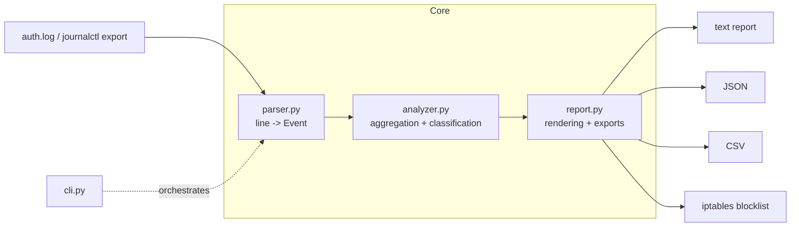

<div align="center">

# 📡 bruteradar

**Detect brute-force attacks, password sprays, and compromise chains in SSH authentication logs — before they become incident reports.**

[](https://www.python.org/)
[](./LICENSE)
[](./requirements.txt)
[](./tests)
[](#%EF%B8%8F-legal--ethical-use)

*Zero dependencies · Pure standard library · Blue-team tooling for SOC analysts, sysadmins, and defenders*

</div>

---

## 📑 Table of Contents

- [Why bruteradar?](#-why-bruteradar)
- [Security Use Cases](#-security-use-cases)
- [Installation](#-installation)
- [Usage Guide](#-usage-guide)
- [Architecture Overview](#-architecture-overview)
- [Detection Logic & Heuristics](#-detection-logic--heuristics)
- [Exit Codes & Automation](#-exit-codes--automation)
- [Project Structure](#-project-structure)
- [Development & Testing](#-development--testing)
- [Security Notes](#-security-notes)
- [Legal & Ethical Use](#%EF%B8%8F-legal--ethical-use)
- [Roadmap](#-roadmap)
- [License](#-license)

---

## 🎯 Why bruteradar?

SSH remains one of the most attacked services on the internet: bots crawl the entire IPv4 space hammering port 22 with recycled credential lists around the clock. Most tools answer *"how many failed logins did I get?"* — the easy question. **bruteradar** answers the questions that actually matter to a defender:

1. **Is this noise, or a targeted attack?** Vertical brute force (one account, hammering), password spray (one IP trying every account once), and distributed spray (a botnet targeting one service account) have completely different response playbooks.
2. **Did anyone get in?** The highest-severity finding in any auth-log review is an **accepted login from an IP that was failing just before it succeeded** — a compromise chain. bruteradar surfaces these in seconds, with the exact line number.
3. **What do I do right now?** Attacker feeds exportable as JSON/CSV for SIEM ingest, plus a ready-to-review iptables blocklist.

The trend it rides: authentication-log triage is now a daily Tier-1 SOC task, and manual `grep | sort | uniq -c` sessions don't scale, don't classify, and never tell you whether an attacker succeeded.

## 🛡️ Security Use Cases

| # | Scenario | What bruteradar gives you |
|---|----------|---------------------------|
| 1 | **Morning log triage** on an internet-facing bastion host | One command: total noise, attacker list ranked by severity, spray targets |
| 2 | **Compromise assessment** after an alert from another source | Compromise-chain detection: failed-then-accepted sequences with line numbers |
| 3 | **Password-spray campaign** against a shared service account (e.g. `svc_backup`) | Distributed-spray detection across multiple attacking IPs |
| 4 | **Feeding a SIEM** (Splunk, Elastic, Wazuh) | `--json` and `--csv` exports for dashboards, alerting, and case notes |
| 5 | **Incident-response timeline** support | Line-numbered findings that map 1:1 back to the original log evidence |
| 6 | **Fast containment decision** | Severity-ranked attacker list + generated iptables drop rules (review, then apply) |
| 7 | **Post-incident audit** of auth logs copied off a compromised host | Offline, read-only analysis — no agents, no network calls, no side effects |

## 📦 Installation

**Requirements:** Python 3.8+ — that's it. No third-party packages.

```bash
# 1. Clone
git clone https://github.com/mehulpatel23b-pixel/bruteradar.git
cd bruteradar

# 2. (Optional) isolate
python3 -m venv .venv
source .venv/bin/activate      # Windows: .venv\Scripts\activate

# 3. (Optional) requirements — documents the zero-dependency guarantee
pip install -r requirements.txt

# 4. Verify the test suite passes on your machine
python3 -m unittest discover -s tests -v
```

No compilation, no install step, no daemons. Run it straight from the repo:

```bash
PYTHONPATH=src python3 -m bruteradar.cli examples/auth.log.sample
```

> Tip: copy a *sanitized* production log to the repo dir for analysis — the `.gitignore` blocks `*.log` so you can't accidentally commit evidence with PII.

## 📖 Usage Guide

### Basic triage

```bash
PYTHONPATH=src python3 -m bruteradar.cli /var/log/auth.log
```

Sample output:

```
==============================================================
bruteradar report
==============================================================
Auth events analyzed : 23
Failed logins        : 20
Accepted logins      : 3
Attacker IPs         : 2

[!!] COMPROMISE CHAINS — accepted login after failures:
     line 11: user 'root' ACCEPTED from 203.0.113.10 after 7 failures

--------------------------------------------------------------
IP               FAILS  USERS  CLASS               SEV
--------------------------------------------------------------
203.0.113.10         7      2  vertical-bruteforce CRITICAL
198.51.100.44       12     12  password-spray      HIGH
--------------------------------------------------------------
```

### Full option reference

| Flag | Effect |
|------|--------|
| `--json FILE` | Full machine-readable report (use `-` for stdout). Ideal for SIEM ingest or scripting. |
| `--csv FILE` | Attacker table as CSV (`ip,failures,accepted,users_targeted,classification,severity`). |
| `--blocklist FILE` | iptables `DROP` rules for every attacker IP — **review before applying**. |
| `--min-failures N` | Failed-logins threshold before an IP is flagged as an attacker (default `5`). |
| `--top N` | Only the top N attackers in the report tables (full data still in JSON/CSV). |

### Real-world recipes

```bash
# Yesterday's journalctl export (ISO timestamps handled natively)
journalctl -u ssh --since "2026-10-19" > ssh.log
PYTHONPATH=src python3 -m bruteradar.cli ssh.log --json report.json

# Low-and-slow hunters: flag IPs with as few as 3 failures
PYTHONPATH=src python3 -m bruteradar.cli /var/log/auth.log --min-failures 3

# Generate containment rules for review (bruteradar NEVER applies them)
PYTHONPATH=src python3 -m bruteradar.cli /var/log/auth.log --blocklist blocklist.txt

# CI-friendly gate: exit code 1 if a compromise chain exists
PYTHONPATH=src python3 -m bruteradar.cli /var/log/auth.log --csv - >/dev/null
```

## 🏗️ Architecture Overview



```
                    ┌──────────────────────────────────────────┐
  auth.log  ───────▶│ parser.py                                │
  journalctl        │  regex extraction → Event(ts, user, ip,  │
  export            │  port, kind, invalid_user, line_no)      │
                    └───────────────┬──────────────────────────┘
                                    ▼
                    ┌──────────────────────────────────────────┐
                    │ analyzer.py                              │
                    │  failures_by_ip · users_by_ip ·         │
                    │  ips_by_user · compromise_chains        │
                    │  classify(): vertical-bruteforce |      │
                    │    password-spray | bruteforce          │
                    │  severity(): CRITICAL..LOW             │
                    └───────────────┬──────────────────────────┘
                                    ▼
                    ┌──────────────────────────────────────────┐
                    │ report.py                                │
                    │  render_text / render_json /            │
                    │  render_csv / render_blocklist          │
                    └──────────────────────────────────────────┘
```

**Design principles**

- **Read-only by construction.** The core library opens exactly one file, in text mode, and never writes, executes, or transmits anything. Blocklists are *generated*, never applied.
- **Deterministic, offline heuristics.** No IP-reputation API calls, no DNS lookups, no telemetry — safe for air-gapped incident response and for logs that are themselves confidential.
- **Evidence-preserving.** Every finding keeps the source line number, so a report row maps directly to log evidence.
- **Pipeline-shaped.** `parser → analyzer → report` are pure functions over data; each stage is unit-tested in isolation and trivially reusable from your own Python code (`from bruteradar.parser import parse_file`).

## 🔍 Detection Logic & Heuristics

| Detection | Rule (defaults) | Severity |
|-----------|----------------|----------|
| Attacker | ≥ `--min-failures` (5) failed logins from one IP | MEDIUM+ |
| Vertical brute force | Attacker targeting ≤ 3 distinct users | HIGH |
| Password spray (single IP) | Attacker trying ≥ 10 users at ≤ 2 attempts each | HIGH |
| Distributed spray | One username failing from ≥ 5 distinct attacker IPs | HIGH |
| **Compromise chain** | Accepted login from an IP with ≥ 5 prior failures in the same log | **CRITICAL** |

Thresholds map directly to `Analysis(...)` kwargs when you use it as a library — tune them to your baseline noise, then lock them in your runbook.

## 🚦 Exit Codes & Automation

| Code | Meaning | Cron/CI usage |
|------|---------|---------------|
| `0` | Analysis complete, **no compromise chains found** | Success |
| `1` | Analysis complete, **≥ 1 compromise chain found** | Trigger pager |
| `2` | Input unreadable / bad path | Fix the path |

```cron
# Non-interactive daily triage: page only when a chain is detected
30 8 * * * cd /opt/bruteradar && PYTHONPATH=src python3 -m bruteradar.cli /var/log/auth.log --json /var/report/ssh.json || (exit 1 | mail -s "bruteradar: possible SSH compromise" soc@example.com)
```

## 🗂️ Project Structure

```
bruteradar/
├── src/
│   └── bruteradar/
│       ├── __init__.py      # package metadata
│       ├── __main__.py      # python -m bruteradar entrypoint
│       ├── parser.py        # raw lines -> Event records
│       ├── analyzer.py      # aggregation, classification, severity
│       ├── report.py        # text / JSON / CSV / blocklist rendering
│       └── cli.py          # argparse CLI, I/O orchestration
├── tests/
│   ├── test_parser.py       # line-level parsing matrix (syslog + ISO)
│   ├── test_analyzer.py     # classification + chain detection on fixtures
│   └── test_report.py       # renderers + round-trip JSON
├── examples/
│   └── auth.log.sample      # synthetic demo log (RFC 5737 documentation IPs)
├── requirements.txt         # documents the zero-dependency guarantee
├── .gitignore               # strict: blocks real logs, secrets, pcap
├── LICENSE                  # MIT
└── README.md
```

## 🔧 Development & Testing

```bash
python3 -m unittest discover -s tests -v     # full suite, no plugins needed
```

The suite builds synthetic logs in memory (no fixture files, no network), covers both supported timestamp formats, every classification bucket, the compromise-chain path, and all renderers — 22 tests across 3 test modules.

Contribution etiquette: keep the zero-dependency guarantee, add a test with every new heuristic, and never weaken `.gitignore` (it deliberately blocks real logs and key material).

## 🛡️ Security Notes

- **No network calls.** No GeoIP lookups, no reputation feeds, no crash reporters. What happens to your logs is your business.
- **No log exfiltration paths.** Outputs go only to files/stdout you name on the command line.
- **`fail(2)` on malformed input**, never a crash: unparseable lines are skipped; unreadable files exit code 2.
- **Logs are treated as confidential.** The `.gitignore` blocks `*.log`, key files, and `.env` so evidence can't leak into a public repo accidentally.
- **The generated blocklist is a recommendation, not an action.** Review each rule before applying; bruteradar has no privilege-escalation or firewall-mutation code paths by design.

## ⚖️ Legal & Ethical Use

bruteradar is a **defensive** tool: it analyzes authentication logs of systems **you own or are authorized to administer**. It performs no scanning, no probing, no attacks. Use it for blue-team work, audits, incident response, and research. Analyzing logs you are not authorized to access may violate law (e.g., CFAA, IT Act) — that's on you; this tool does nothing without a log you supply.

## 🗺️ Roadmap

- [ ] GeoIP enrichment via optional **offline** MaxMind database (opt-in, still no network)
- [ ] `system-auth` (RHEL) and `btmp`/`wtmp` formats
- [ ] Sliding time-window analysis for low-and-slow detection
- [ ] HTML report mode for sharing findings with non-technical stakeholders

## 📄 License

[MIT](./LICENSE) © 2026 Mehul Patel
